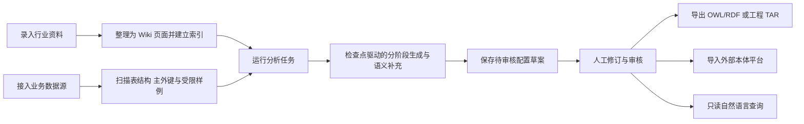

# 数智本体 Wiki 资产系统

面向本体工程师和业务开发人员的本体建设与治理平台。系统将业务资料沉淀、数据库结构分析、本体配置候选生成、人工审核、外部平台导入和只读数据查询串联为一条可追溯的工作流。

> 当前为模块化单体架构：后端为 Spring Boot 应用，前端为 Vue 单页应用；LLM Wiki、结构扫描、候选生成和查询编译均在后端进程内完成，不依赖额外的 Wiki 或 Python 服务。

## 功能特性

- **Wiki 知识空间**：按行业/业务域组织资料，支持文本录入与 TXT、Markdown、CSV、JSON、YAML、SQL、XML、LOG 等文本文件导入。
- **LLM Wiki**：将原始资料整理为可累积的 Markdown Wiki 页面并建立页面索引，用于后续问答和本体分析。
- **数据源接入**：支持 MySQL、PostgreSQL、Hive JDBC，提供连接测试、结构扫描、主外键读取和按表选择的受限样例读取。
- **分析任务**：结合数据源结构、受限样例和指定知识空间的资料，分阶段生成对象、属性、关系、逻辑、公理、动作和查询语义等候选，并保存进度、检查点和结构快照。
- **配置草案**：展示候选配置及证据，支持人工修改、版本差异对比、增量重扫、OWL/RDF 或工程 TAR 导出、沙箱测试和外部平台导入。
- **业务问答**：按全部资料、知识空间、单个资产或分析任务范围问答，展示引用来源，并可将回答另存为 Wiki 页面。
- **数据查询**：基于已审核草案的指标、维度、时间字段和关系，将自然语言转换为受限查询计划，经校验后编译为参数化只读 SQL，返回表格、图表建议、CSV 和查询历史。
- **MCP 服务**：通过 `POST /mcp` 暴露 Wiki 问答、资料检索、分析任务查询和结果沉淀等工具，支持生成专用访问令牌接入 Claude Desktop、Cursor 等 MCP 客户端。
- **系统管理**：登录、验证码、JWT、动态菜单、用户、角色、部门、字典、操作日志和系统监控。

## 技术栈

| 层次 | 技术 |
|---|---|
| 前端 | Vue 2.6、Element UI 2.15、Vue Router 3、Vuex 3、Vue CLI 4、ECharts 5 |
| 后端 | Java 8、Spring Boot 2.5、Spring Security、JWT、MyBatis、Spring JDBC |
| 数据访问 | Druid 连接池、PageHelper 分页、MySQL / PostgreSQL / Hive JDBC |
| 元数据存储 | MySQL |
| 缓存 | Redis |
| 模型接口 | OpenAI Chat Completions 兼容 API |
| 构建 | Maven 多模块、npm |

## 项目结构

```text
ontology-wiki/
├── backend/                       # Maven 多模块后端
│   ├── ontology-admin/            # Spring Boot 启动入口与运行配置
│   ├── ontology-framework/        # 安全、JWT、Redis、Druid、Web 基础设施
│   ├── ontology-system/           # 用户、角色、菜单、部门等系统管理
│   ├── ontology-core/             # Wiki、数据源扫描、候选生成、草案与问答
│   ├── ontology-query/            # 自然语言查询、计划校验、SQL 编译与历史
│   ├── ontology-scheduler/        # 定时任务
│   ├── ontology-generator/        # 代码生成
│   ├── ontology-common/           # 公共组件与工具
│   └── sql/                       # 数据库初始化与增量脚本
├── frontend/                      # Vue 前端
│   └── src/views/ontology/        # 工作台、资料、数据源、分析、草案、问答、查询页面
├── docs/                          # 产品、架构与实施文档
├── scripts/                       # 本地冒烟脚本
└── README.md
```

## 快速开始

### 1. 环境要求

- JDK 1.8
- Maven 3.6+
- MySQL 5.7+ 或 8.0
- Redis 5+
- Node.js 8.9+ 与 npm 3+

### 2. 初始化数据库

创建专用数据库：

```sql
CREATE DATABASE `ontology-wiki`
  DEFAULT CHARACTER SET utf8mb4
  COLLATE utf8mb4_general_ci;
```

导入初始化脚本：

```sh
mysql -h 127.0.0.1 -P 3306 -u root -p ontology-wiki < backend/sql/ontology-wiki.sql
```

> 初始化脚本会创建系统表、业务表并写入菜单与权限数据，其中包含 `DROP TABLE`。只允许在空库执行；已有数据的库请先备份，不要重跑该脚本。

后续增量变更可参考 `backend/sql/` 下的 `migrate-*.sql`。

### 3. 修改配置文件

启动前直接修改下面两个文件中的连接信息即可，无需创建额外的环境变量文件。仓库中的值均为占位默认值，请勿提交真实密码。

| 文件 | 配置项 | 说明 |
|---|---|---|
| [application-druid.yml](backend/ontology-admin/src/main/resources/application-druid.yml) | `spring.datasource.druid.master.url` | 元数据库 JDBC 地址 |
| 同上 | `spring.datasource.druid.master.username` | 元数据库用户名 |
| 同上 | `spring.datasource.druid.master.password` | 元数据库密码 |
| [application.yml](backend/ontology-admin/src/main/resources/application.yml) | `spring.redis.host/port/database/password` | Redis 连接信息 |
| 同上 | `token.secret` | JWT 签名密钥，建议替换为 64 位以上随机字符串 |
| 同上 | `ontology.integration.credential-key` | 数据源密码加密密钥，建议替换为 32 位以上随机字符串 |
| 同上 | `ontology.integration.llm-wiki.*` | 启用并配置 OpenAI 兼容模型接口与 API Key |

如需接入智文服务或外部本体平台，可在 `application.yml` 中填写对应的 `ontology.integration.zhiwen`、`ontology.integration.platform` 配置；未启用时不会发起外呼。

### 4. 启动后端

```sh
cd backend
mvn -pl ontology-admin -am clean package -DskipTests
java -jar ontology-admin/target/ontology-admin.jar
```

默认地址：`http://localhost:8080`。

也可以在 IDE 中直接运行 `com.ontologywiki.OntologyWikiApplication`。

### 5. 启动前端

```sh
cd frontend
npm install
npm run dev
```

默认地址：`http://localhost:5173`。开发代理会将 `/dev-api` 转发到 `http://localhost:8080`。

生产构建：

```sh
npm run build:prod
```

### 6. 登录

初始化脚本内置管理员账号 `admin`，初始密码 `admin123`。首次登录后请立即修改密码，并在生产环境删除或禁用不需要的演示账号。

## 核心流程



分析任务使用阶段检查点、取消和恢复机制；人工修正更新的是本体配置，不会执行用户描述的 DDL 或改写源数据库结构。外部平台导入针对已完成审核的草案，后续校验、推理和运行由目标平台按其能力处理。

## 查询架构

自然语言查询以已审核草案为语义边界：语义目录提供可用指标、维度、时间字段和关系，查询规划器生成受限计划，计划校验器按允许的目录和策略检查，SQL 编译器生成参数化只读 SQL，最后由 JDBC 查询 DAO 执行并记录历史。该机制不等同于完整的企业级行列级权限引擎。

## 主要接口

| 接口 | 说明 |
|---|---|
| `GET /ontology/{resource}/list` | 列表查询，资源包括 `spaces`、`assets`、`datasources`、`analyses`、`proposals`、`imports` |
| `POST /ontology/datasources/test` | 测试数据源连接 |
| `POST /ontology/datasources/{id}/scan` | 扫描数据源结构 |
| `POST /ontology/analyses/{id}/analyze` | 执行分析任务并生成草案 |
| `GET /ontology/analyses/{id}/job` | 查询分析任务进度与检查点 |
| `GET /ontology/analyses/{id}/export?format=rdf\|project` | 导出最新草案为 OWL 或工程 TAR |
| `POST /ontology/proposals/{id}/import` | 导入已审核草案到外部本体平台 |
| `POST /ontology/wiki/ask` | Wiki 知识问答 |
| `POST /ontology/wiki/assets/{id}/ingest` | 整理资产并生成 Wiki 页面 |
| `GET /ontology/data-query/catalog/{proposalId}` | 查询可用的指标、维度与时间字段 |
| `POST /ontology/data-query/plan/{proposalId}` | 将自然语言解析为受限查询计划 |
| `POST /ontology/data-query/execute/{proposalId}` | 校验并执行只读查询 |
| `POST /ontology/data-query/drilldown/{proposalId}` | 按维度下钻查询 |
| `GET /ontology/data-query/history/{proposalId}` | 查询历史 |
| `POST /mcp` | MCP over HTTP（JSON-RPC 2.0），提供 `wiki_query`、`search_wiki`、`list_wiki_spaces`、`list_analysis_tasks`、`get_analysis_status`、`get_analysis_candidates`、`run_analysis`、`chat_analysis`、`save_analysis_result` 等工具 |

## 主要数据表

| 表 | 用途 |
|---|---|
| `wiki_space` | Wiki 知识空间 |
| `wiki_asset` | 原始资料与生成的 Wiki 页面 |
| `ontology_datasource` | 外部数据源连接信息与加密凭证 |
| `analysis_task` | 分析任务范围、状态与摘要 |
| `ontology_proposal` | 本体配置草案 JSON 与审核状态 |
| `ontology_import_record` | 外部平台导入结果 |
| `wiki_chat_session`、`wiki_chat_message`、`wiki_chat_citation` | 问答会话、消息与引用 |
| `ontology_query_evaluation` | 查询评测结果 |
| `ontology_mcp_token` | MCP 访问令牌（仅保存 SHA-256 摘要） |

## 安全说明

- 仓库不保存数据库地址、账号、密码、Redis 密码、JWT 密钥、模型 API Key 或平台 Token；启动前在配置文件中填写实际值，且不要把修改后的配置提交到仓库。
- 数据源密码使用 `ontology.integration.credential-key` 进行 AES-GCM 加密后写入 `ontology_datasource.password_enc`，接口不返回已保存密码。密钥变更后历史密文将无法解密，请妥善保管并做好备份。
- MCP 访问令牌只在生成时展示一次明文，数据库仅保存 SHA-256 摘要；令牌不具备分析写权限，`run_analysis` 只返回操作指引。
- 样例数据遮蔽基于字段名规则，不等同于完整的生产级脱敏；接入方应使用最小权限账号并选择安全样例。
- Druid 监控页默认关闭；生产环境如需开启，请设置独立强密码并限制访问来源。
- 生产部署建议启用 HTTPS、限制 CORS 与来源域名，并按角色最小化菜单与接口权限。

## 已知限制

- 未内置向量库或本地 Embedding 模型，Wiki 问答基于页面索引和模型完成，不使用传统向量 RAG。
- 候选生成中的关系、公理、逻辑、动作和权限均为待审配置候选，需人工修订和审核，不代表已确认的业务事实。


## 许可证

本项目基于 RuoYi 管理框架进行二次开发。RuoYi 及其引入的第三方组件遵循各自的开源许可证；仓库当前未附带统一的 `LICENSE` 文件，对外分发或商用前请补充许可证声明并核对上游许可条款。
